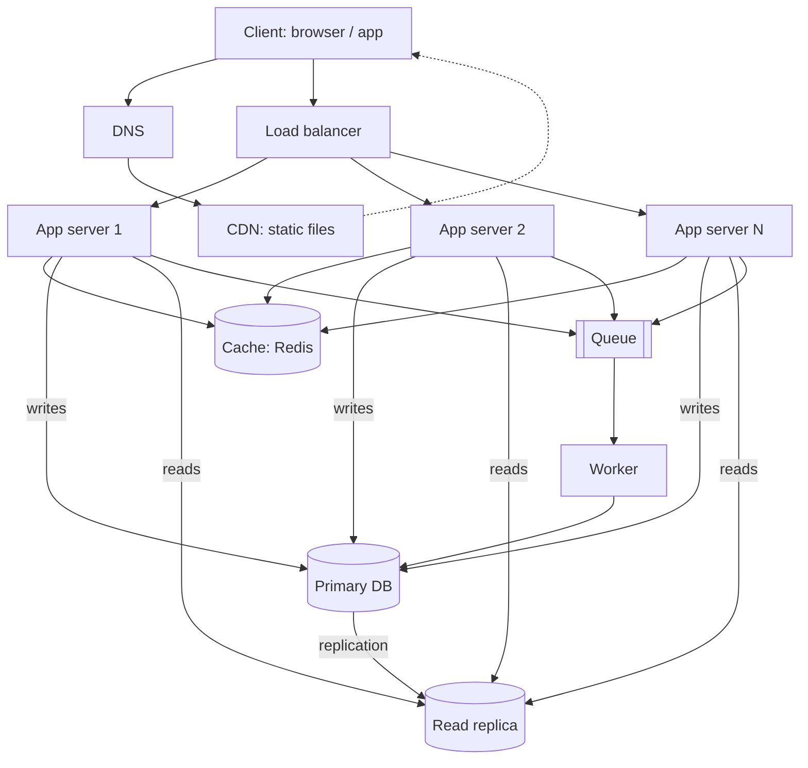

# QuickNotes Architecture

## Requirements

**Functional:** register/log in; create, read, update, delete notes; tag notes and filter by tag; list notes with pagination; (async) send a welcome/summary email.

**Non-functional:** availability 99.9%; p95 latency under 300 ms; durability (no lost notes); security (HTTPS, hashed passwords, per-user access); horizontal scalability; maintainability.

## Load estimate (1 million users)

Assumptions: 20% daily active (200k), each reads notes 20 times/day and writes 2 notes/day, average note 1 KB, peak = 3x average.

- **Reads:** 200k x 20 = 4M/day = ~46/s average, **~140/s peak**. (With 1M users all active it would be ~700/s peak; the design handles this.)
- **Writes:** 200k x 2 = 400k/day = ~5/s average, **~15/s peak**.
- **Storage per year:** 400k x 365 = 146M notes x ~1 KB = **~150 GB/year** (about 300 GB with indexes and replica overhead excluded from the raw figure).

Reads outnumber writes about 10:1, so caching and read replicas pay off.

## Diagram

## Components

- **Client:** shows notes and calls the API over HTTPS.
- **DNS:** turns `quicknotes.example` into the address of the CDN/load balancer, so we can move servers without changing the URL.
- **CDN:** serves HTML/CSS/JS from locations near users, cutting latency and load on our servers.
- **Load balancer:** spreads requests across app servers and removes unhealthy ones via health checks.
- **App servers (2+):** stateless servers running the API logic, so we scale by adding more.
- **Cache (Redis):** keeps hot reads (note lists, sessions) in memory to relieve the database.
- **Primary database:** the single source of truth that accepts all writes.
- **Read replica:** serves read queries and acts as a standby, spreading the read load.
- **Queue:** holds slow jobs (emails, exports) so the API can answer immediately.
- **Worker:** takes jobs from the queue and processes them in the background.

## Request flows

**GET /notes**
1. Client sends the request; DNS resolves to the load balancer.
2. Load balancer picks a healthy app server.
3. The server validates the token.
4. It checks the cache key `notes:{user}:{cursor}`.
5. Cache hit: return the JSON. Cache miss: query the read replica, store the result in the cache (TTL 60 s), return it.
6. Response `200 OK`.

**POST /notes**
1. Client sends the request through DNS and the load balancer to an app server.
2. The server validates the token and the body (title 1-100 characters); failures return `400`.
3. It inserts the note into the primary database.
4. It invalidates the user's cached note lists.
5. It publishes a job to the queue (e.g. activity email); the worker handles it later.
6. Response `201 Created` with the new note.

## Trade-offs

1. **Cache vs consistency:** caching makes reads fast but a list can be up to 60 s stale; we invalidate on writes and accept brief staleness elsewhere.
2. **Read replica lag:** replication is asynchronous, so a read right after a write may miss it. We can read from the primary for the user's own just-written data.
3. **Queue adds complexity** (retries, idempotent jobs) in exchange for fast API responses.
4. **SQL on a single primary** is simple and consistent but writes do not scale horizontally; sharding by `user_id` is the later step.

## Avoiding single points of failure

- Two or more app servers behind a redundant load balancer pair; health checks remove failed nodes.
- The read replica can be promoted if the primary fails (automatic failover); backups are taken daily.
- Redis runs with a replica; if the cache is lost the app falls back to the database.
- The queue is replicated/managed and jobs are retried; multiple workers run.
- Deploy across at least two availability zones; use a managed DNS and CDN.
